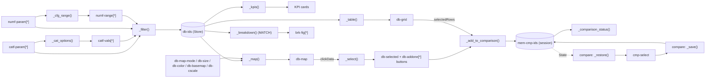

# Architecture

The app is a multi-page [Dash](https://dash.plotly.com/) application. Dash *pages* (`use_pages=True`) are
discovered automatically from the `pages/` folder; shared logic lives in `components/`.

```
app.py                  Dash app, navigation bar, page container, per-tab memory stores (entry point; server = app.server)
pages/                  one module per page, each calls dash.register_page(...)
  home.py               "/"          Overview: KPIs, dynamic filters, bubble map, breakdown charts, data table
  compare.py            "/compare"   Compare 2–6 offers (query string ?course_ids=NO-001,SE-004 optional)
  about.py              "/about"     The app, dataset variables, vocabulary, caveats, sources, contact
components/             shared, page-independent code
  data.py               Excel loading (cached, auto-reload on file change) + dictionary / vocabulary helpers
  figures.py            Plotly figure builders (bubble map, count bars, compare bars, points map)
  ui.py                 app name, small layout helpers (card, control, kpi, graph, ext_link), shared settings
assets/style.css        styling, auto-loaded by Dash
assets/dashAgGridComponentFunctions.js   AG Grid cell renderer 'ExternalLink' for url columns
assets/favicon.ico      browser-tab icon (SINTEF), served automatically by Dash
assets/logos/           SINTEF and IBPSA Nordic logos (navigation bar), NSBI logo (About page)
data/                   the Excel dataset
docs/                   documentation and the project graph explorer
```

## Layers

1. **Data** – `components/data.py::get_data()` reads `data/smart_building_education_dataset.xlsx` into a
   `Dataset` (courses, data_dictionary, vocabulary, sources). The result is cached and reloaded when the file's
   modification time changes. While loading, ids and text are cleaned, numeric columns converted, `region` is
   filled from `country` when empty, and the computed column `n_topics` is added.
2. **Metadata-driven UI** – dropdown contents come from the `data_dictionary` sheet via `columns_for(use, kind)`
   and `dropdown_options(...)`, according to the column `dtype`:

   | dtype | Used for |
   |---|---|
   | `numeric` | numeric filters (range slider), bubble size and colour, compare bars |
   | `categorical` | category filters, bubble colour, breakdown charts ("count by" and "split by"), coverage matrix |
   | `multi` | category filters (match = contains any selected value), breakdown "count by", coverage matrix |
   | `text`, `url`, `date` | tables and the compare page only (`url` shown as a link) |

   Values of categorical and multi-valued columns are ordered and described by the `vocabulary` sheet
   (`value_options()`, `value_counts()`, `value_description()`). No column names are hard-coded in the dropdowns.
3. **Figures** – `components/figures.py` turns a (filtered) DataFrame into Plotly figures (pure functions).
   `category_colors()` gives every category value a stable colour (vocabulary order), whatever the filters.
4. **Pages** – each page defines `layout(**query_params)` (a function, so options are rebuilt on every page
   load) and its callbacks with `@callback`.

## Overview data flow (pages/home.py)

All filters feed a single callback, `_filter()`, which stores the ids of the matching offers in a `dcc.Store`
(`#db-ids`). Every view (KPI cards, map, breakdown charts, table) listens to that store.

### Dynamic filters (pattern-matching callbacks)

Category and numeric filters are lists of rows that the user can add (`+ Add …`) and remove (✕). Each row's
components use dictionary ids, e.g. `{"type": "catf-param", "index": 3}`:

| Row type | Components (`type`) | Per-row callback (MATCH) |
|---|---|---|
| Category filter | `catf-row`, `catf-param`, `catf-vals`, `catf-del` | `_cat_options()`: parameter → value list (with counts) and placeholder |
| Numeric filter | `numf-row`, `numf-param`, `numf-range`, `numf-del` | `_cfg_range()`: parameter → slider min/max/step |

`_edit_cat_filters()` / `_edit_num_filters()` append or delete rows with a `Patch`; `_cat_del_visibility()` /
`_num_del_visibility()` keep at least one row of each kind; `_reset()` replaces both lists with one fresh row each.
Multi-valued parameters match with `components.data.match_values()` ("contains any of the selected values").

### Map, breakdown charts, table and comparison

- `_map()` draws `map_figure()` per offer (offers at the same place are spread on a small spiral around it) or per
  place (`db-map-mode`; bubble size = number of offers, colour = mean or most frequent value).
  `_size_disabled()` disables the size dropdown per place. Bubble `customdata` = course id(s) (`id1|id2`).
- `_select()` lists the offers of a clicked bubble with their web page and an *Add to comparison* button
  (`{"type": "db-addone", "index": <course_id>}`).
- `_breakdown()` (MATCH on `brk-by` / `brk-split` / `brk-fig`) draws `count_bars()`.
- The AG Grid table has tick boxes (`rowSelection`, row id = `course_id`); *Add ticked offers to comparison*
  and the *Add to comparison* buttons call `_add_to_comparison()`, which writes `mem-cmp-ids` (max 6).
  `_comparison_status()` shows the count and a link to the Compare page.



## Compare page (pages/compare.py)

`cmp-select` holds the selected offers. When the page opens, `_restore()` (triggered by `dcc.Store(id="cmp-init")`)
takes the offers of the link (`?course_ids=…`) or else the tab memory `mem-cmp-ids`; `_save()` writes every change
back to the memory. `_table()` builds the key-facts table (all dictionary columns by group; options *Hide empty
rows* / *Only rows that differ*), `_matrix()` the coverage matrix of a categorical or multi-valued parameter
(all vocabulary values), `_bars()` and `_map()` the figures. Offers keep the same colour in all views.

## Memory of user selections (per browser tab)

- Simple controls (map options, breakdown dropdowns, table search, compare options) use Dash persistence:
  `**PERSIST` from `components/ui.py` (`persistence=True, persistence_type="session"`).
- `dcc.Store(id="mem-db-filters", storage_type="session")`: the dynamic filter rows (saved by `_save_filters()`,
  rebuilt by `_restore_filters()` when the Overview opens).
- `dcc.Store(id="mem-cmp-ids", storage_type="session")`: the offers selected for comparison.

sessionStorage lives only in the browser: separate for every tab and user, never stored on the server, cleared
when the tab is closed.

## Conventions

- Component ids are prefixed per page: `db-` (Overview), `cmp-` (Compare); pattern-matching ids use a `type` key
  (`catf-…`, `numf-…`, `brk-…`, `db-addone`) and an `index`.
- Callback functions are private (`_name`) and live in the page module that owns the components.
- Missing = empty cell (NaN), never 0; multi-valued cells are separated by `;`.
- Adding a page: create `pages/<name>.py` with `dash.register_page(__name__, path=..., name=..., order=...)`
  and a `layout()` function. It appears in the navigation bar automatically.
